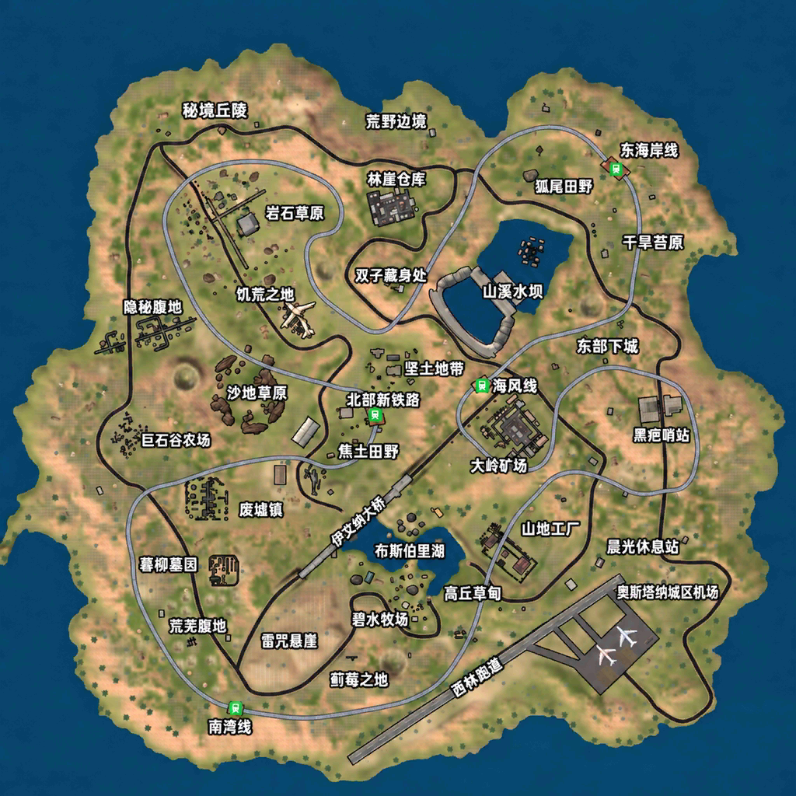

# 当前正式版：0.14.90

[下载正式版](https://github.com/zqzhuhai-commits/Swag-Shooter-Switch/releases/tag/v0.14.90) · [本次发布说明](RELEASE-0.14.90.md)

# 绝地精英 AI增强版 0.14.90 / Xiao Fan

Atmosphère 原生单文件 NSP，应用 ID：01AF534741470000。

## 本次正式发布

- 恢复游戏原始准心及颜色设置，撤回曾造成实战黑方块的四种自定义样式、材质覆盖和画布重建处理。
- 合并近期第三人称视角、步态与输入适配；支持按住 ZL 开镜时陀螺仪辅助瞄准。
- 保留中文地图、四档 AI、52人13支四人小队、缩圈和圈外伤害适配、离线奖励与存档。
- 保留第三人称曳光显示调整；不将模拟校验视作弹道对齐的全面实机验证。

## 安装与操作

下载 Swag-Shooter-0.14.90.zip，解压后安装 NSP；无需额外资源或 NRO。升级前备份 SD /switch/swag-userdata/、/switch/swag-ai.cfg，若使用体感自定义配置也备份 /switch/swag-gyro.cfg。

左摇杆移动；L3短按切换跑步、长按切换视角；右摇杆转动视角；R3短按趴下、长按交互/上车。B跳跃，A短蹲/长趴，Y短按拾取第一项/长按换弹，X切枪。ZL按住开镜，ZR开火；L医疗，R手雷；+地图，-背包。驾驶自动识别：左摇杆前后、右摇杆左右，十字键四向亦可，ZR油门、ZL倒车/刹车、A下车。

体感仅在有效步战且按住ZL开镜时辅助瞄准。线上与私人服务器保持锁定，不提供局域网联机。

## 发布与验证

2026年11月3日用户批准正式发布。使用刚才交付的同一份0.14.90 NSP，不重新编译。编译、原始准心文件逐字节一致、原自定义挂钩移除、菜单预览恢复、1876项内嵌资源哈希和独立NSP校验通过。正式发布授权不代表所有地图、设备和玩法均已穷尽实测；0.14.90恢复后的准心效果尚未收到单独实机反馈。

NSP SHA-256：de6c528b580559349aacdd57ba0e71e054769e7a508256dc345331537b26ed1a

---

以下保留操作与历史适配说明；历史测试版标记不代表当前下载版本。

# 绝地精英 AI增强版 — 游戏说明

名称：**绝地精英**；作者：**Xiao Fan**；版本：**0.14.72（源码／测试版）**。

> 当前公开正式版仍为0.14.58；本文更新至0.14.72测试源码。第三人称、中文地图及新的红边规则不在旧正式包中。[0.14.58历史说明](docs/GAME_GUIDE-0.14.58.zh-CN.md)。

面向 Nintendo Switch Atmosphère 的安卓 ARM64 Unity 游戏兼容移植，以离线 AI 对局为主。Release 提供包含完整游戏资源和图标的单文件 NSP，无需另外放置 NRO 或游戏资源目录。支持手柄及掌机触摸。

## 安装、升级与存档

1. 正式版从 Releases 下载；0.14.72当前是测试版，已单独提供测试NSP，尚未建立新的正式Release。安装对应版本的单文件NSP。
2. 应用 ID 为 `01AF534741470000`，作者显示 Xiao Fan，使用 AI增强版图标。升级采用相同应用 ID。
3. 覆盖安装时保留原存档。升级前可备份 SD 卡 `/switch/swag-userdata/` 和 `/switch/swag-ai.cfg`；不要为了升级而删除它们。
4. 历史启动诊断补丁 `/atmosphere/exefs_patches/swag-startup-diag` 不属于当前安装包，若仍保留应移除。
5. 首次加载或缓存重建时可能比后续启动慢；启动显示简化的等待页面。暂未给出不同设备、SD 卡速度下的统一加载时间或帧率保证。

游戏数据和缓存位于 `/switch/swag-userdata/`，AI 难度另存于 `/switch/swag-ai.cfg`。本项目使用的 SD 数据目录不同于单纯依赖系统存档管理的游戏；只备份系统存档可能不包含这些文件。

## 对局与组队规则

提供游戏已有的离线玩法，包含经典、死亡竞赛、狙击、斧头、匕首及自由模式；实际可选项目以模式菜单为准。线上和私人服务器入口保持锁定，本版不提供局域网联机。

**经典组队模式的目标是 52 人、13 支四人小队**：

- 玩家与 3 名 AI 队友同队。
- 其余 48 名 AI 组成 12 支独立四人小队，各队互为敌方。
- 某队最后一名成员死亡，该队才被淘汰。
- 最后只剩一支有存活成员的队伍时，该队获胜；胜利队可以剩 1～4 人。
- 玩家死亡但仍有队友存活，不等于队伍团灭。我方全队淘汰可以进入失败结算，无需等其他敌队打完。

上述 52 人编队适配仅用于经典组队，其他玩法保留各自原有规则，不能把所有模式理解为统一 52 人。

## AI 难度

在设置中的“游戏难度”选择，四档从低到高为：

| 难度 | 说明 |
| --- | --- |
| 简单AI | 较宽松的射击和行动参数 |
| 普通AI | 默认档，作为基准参数 |
| 困难AI | 更准确的射击、更短的停顿，以及可用的战术动作 |
| 精英AI | 当前最高档；进一步提高精度、缩短射击停顿和战术停留 |

精英档保留个体差异及参数下限。当前增强主要调整枪械散布、射击间隔和已有战术行为，不能理解为加入了完整的新战术推理系统。首页、设置与加载界面的难度显示统一读取保存的选择。

## 缩圈节奏

本版采用 **Livik 参考的 52 人快节奏适配方案**。PUBG Mobile 官方帮助说明 Livik 支持 52 人、约 15 分钟，但以下逐圈秒数是本项目自定义参数，并非官方原表。

| 阶段 | 等待后开始缩圈 | 单次收缩时长 | 本阶段总时长 |
| --- | --- | --- | --- |
| 1 | 3分00秒 | 1分30秒 | 4分30秒 |
| 2 | 2分00秒 | 1分15秒 | 3分15秒 |
| 3 | 1分30秒 | 1分00秒 | 2分30秒 |
| 4 | 1分15秒 | 45秒 | 2分00秒 |
| 5 | 1分00秒 | 30秒 | 1分30秒 |
| 6 | 45秒 | 30秒 | 1分15秒 |

前六阶段等待与收缩**合计 15 分钟**，不含启动加载。提早获胜可以提前结束；若仍需继续收缩，后续阶段沿用第六阶段时间直到原游戏的最小圈规则生效。因此不能承诺每局恰好在第 15 分钟结束。

收缩幅度依次按当前直径缩小 25%、35%、40%、45%、50%、50%；后续沿用 50%，受原最小圈尺寸限制。这里的百分比是直径减少量，不是面积，也不是每次只保留该比例。

参考：[PUBG Mobile 官方 Livik 说明](https://pubgmobile.helpshift.com/hc/en/3-pubg-mobile/faq/287-i-want-to-know-about-livik/?l=en&s=corporation-information)。

## AI 进圈与圈外伤害

所有实际启用安全区的离线模式使用同一套进圈检查。AI 根据有效下一圈设置分散的圈内目标，通过原生 NavMesh 选择可行走点；没有有效下一圈时以当前圈为目标。原战斗/掩体更新之后再次提交移动，减少目标被覆盖的情况，翻越、闪避及载具交互期间保留原动作。

0.14.56 针对“末圈仍有 36 人滞留圈外”的反馈增加了以下处理：

- 根据当前可见圈更新原生圈内判断使用的中心和半径缓存。
- 按实际玩家名单逐秒检查圈外 AI，不只依赖枪械初始化登记。
- 连续两次圈外检查未看到血量下降时，才通过原生血量接口补偿扣血；看到原有伤害时跳过补偿。
- 各阶段补偿量为每秒最大血量的 1%、2%、3%、5%、8%、12%，后续沿用 12%。这表示补偿量，不是对原游戏所有伤害的统一替换。
- 血量真正归零后补齐原生死亡流程，并核对小队淘汰和剩余人数，避免零血但计数不变。

寻路受地图可行走面、障碍物和原 AI 行为限制。本版的实际进圈效果和完整死亡事件流程仍需实机复测；不能把主机逻辑检查当作所有机器人均能成功进圈的证明。

## 低血量渐变红边

- 血量低于最大血量的 50% 时启用，血量越低越明显。
- 屏幕周边使用向内平滑变透明的红色渐变，扩大边缘覆盖范围，中央瞄准区域完全透明。
- 血量在30%～50%时每秒一个完整明暗循环（1 Hz）；低于30%时每0.5秒一个循环（2 Hz）。亮度在当前基础强度的60%～100%之间连续变化，不会突然亮灭。
- 基础最大不透明度为 45%，保留淡入淡出；回血后淡出，死亡、暂停、结算或退出对局时清除。
- 这是视觉提醒，不改变伤害、护甲或生命数值，也不拦截触摸输入。

## Switch 步战按键

以下按 **Switch 实体按键标识**书写，不是 Xbox 字母位置。长按阈值约为半秒。

| 按键 | 功能 |
| --- | --- |
| 左摇杆 | 移动 |
| L3 短按（按左摇杆） | 切换跑步状态 |
| L3 长按 | 切换第一／第三人称，按住ZL瞄准时回到第一人称 |
| 右摇杆 | 转动视角 |
| R3 短按 | 趴下 |
| R3 长按 | 交互／上车，需附近存在相应入口 |
| B | 跳跃 |
| A 短按／长按 | 蹲下／趴下 |
| Y 短按 | 拾取列表第一行物品 |
| Y 长按 | 换弹 |
| X | 在主武器与手枪之间切换 |
| ZL 按住／松开 | 开镜／关镜 |
| ZR 按住 | 开火 |
| L 松开 | 使用医疗物品 |
| R 松开 | 使用手雷入口 |
| 十字键左／右 | 主武器／手枪 |
| 十字键上 | 跳伞入口 |
| 十字键下 | 切换物品 |
| ＋ | 地图 |
| － | 背包 |
| L＋Y 短按 | 备用开门／交互入口 |

通常直接使用单键。菜单可以触摸操作；触摸在掌机屏幕上使用。按键通过游戏原触控入口适配，某些功能要求对应按钮在当前界面出现。未独立适配屏息、侧身、地图标记、自由观察等全部 PUBG 手柄功能；移植版按键不能等同于 PUBG 官方完整操作表。光标模式已取消。

## 驾驶按键

自动读取本地玩家的驾驶状态，不需要手动切换。

| 按键 | 功能 |
| --- | --- |
| 左摇杆上／下 | 前进／倒车；左右不用于转向 |
| 右摇杆左／右 | 左转／右转；上下不用于油门 |
| 十字键四向 | 前进、倒车、左转、右转 |
| ZR | 油门／前进 |
| ZL | 刹车／倒车入口 |
| A | 下车 |

驾驶时右摇杆用于转向，不再同时转动视角。若自动状态读取失败，保留 L＋R 作为备用切换。载具必须使用游戏当前界面支持的方向控制方式；不同载具的完整体验仍待逐项确认。

## 第三人称与动画（0.14.72测试版）

默认第一人称，长按L3切换第三人称。当前机位带0.18米的小幅右移，使人物稍在画面左侧，避免头部挡住中央准星；不是早期0.45米的右肩机位。开镜恢复第一人称瞄准。

人物与枪口朝向问题已收到实机正常反馈。后续仍在调整步态：普通行走目标约每秒0.45个完整步态周期，跑步约0.65个，一个完整周期通常含左右脚各一步。这是动画控制目标，不是人物移动速度，也不是已测得的硬件结果。

上半身采用微幅稳定，保留少量自然摆动；换弹、跳跃、攀爬和非行走状态交还原动画。第三人称镜头、遮挡、脚部滑动和实际步频仍待持续实测。

## 中文地图

0.14.69及之后测试版的大地图和小地图采用中文地名贴图。原地名烘焙在图片中，本地化后图像并非与原地图地形像素完全相同，标记与道路位置仍需实机核对。

## 商店、奖励与中文

商店按离线方式进入，本地购买和激励奖励调用原游戏发放流程，不要求观看外部广告。首次数据初始化时，现金、金币和钻石各设置为 10,000,000；已存在初始化标记和存档时保留之后的消费、奖励和物品记录，不在每次启动重置余额。

“服务器”在难度设置相关页面改为“游戏难度”；“磁铁目标”对应“辅助瞄准”。洞穴提示统一为：

- “物资洞穴将在20秒后开启，请查看小地图确定位置。”
- “物资洞穴将在10秒后关闭，请尽快离开！”

界面使用现有中文字体适配。启动、菜单及加载图中的游戏名替换为绝地精英；加载提示署名显示小帆。已禁用白屏且无法领取的皇家骑士首屏推广弹窗。模式、物品与布局不同，仍可能有未发现的翻译或文字缺失问题。

## 性能与诊断日志

安卓工作线程根据进程权限优先在核心 1、2 调度，主线程沿用现有配置；这不会自动把主线程逻辑拆成并行任务，也不保证三个核心均衡占用或固定帧率。

默认关闭诊断日志。复现问题需要日志时：

1. 在 SD 卡 `/switch/` 下创建空文件 `swag-debug.flag`，注意不要附带 `.txt` 扩展名。
2. 重新启动游戏并复现问题。
3. 保留 SD `/switch/swag-switch.log`；若生成崩溃日志，也一并保留 `swag-switch-crash.log`。
4. 排查完成后删除 `swag-debug.flag`，下次启动恢复默认关闭。已有日志不会自动删除。

圈相关诊断包含 `AI_ZONE_STATUS`、`AI_ZONE_DAMAGE`、`AI_ZONE_ROUTE`；组队包含 `SQUAD_ROSTER`、`SQUAD_DEATH` 和 `SQUAD_FINISH`。请同时记录版本、模式、难度、对局时间和看到的存活人数，避免混用旧版本日志。

## 发布与验证状态

本文对应源码／测试版0.14.72。已完成Switch编译、包含步态反馈限速策略的ARM64规则回归、NRO内置1875文件逐项哈希、独立NSP结构与内容校验。

用户确认过0.14.67不再出现首屏推广弹窗，0.14.68第三人称人物／枪口方向正常；随后继续反馈步频、上半身晃动和准星遮挡问题。0.14.72针对此继续调整，机位与步频效果尚待实机确认。

公开正式Release仍为0.14.58，安装包和原版说明保持原发布内容。源码更新不等同于新的正式发布，也不代表所有模式、武器、载具和地图均已穷尽实机验证。
