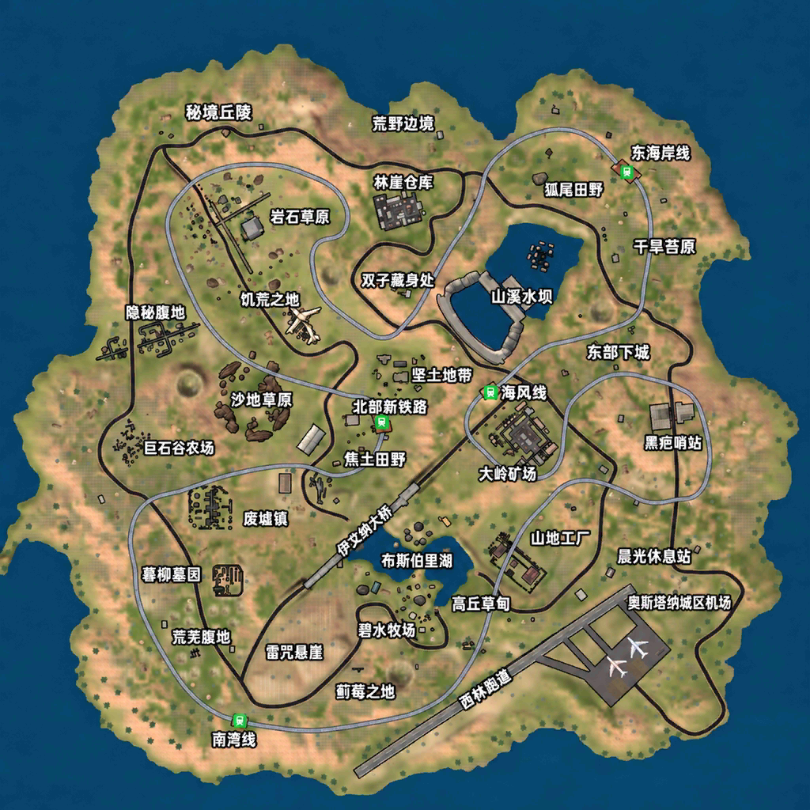

# 绝地精英 AI增强版

**作者：Xiao Fan** · Nintendo Switch / Atmosphère · 离线 AI 大逃杀

《绝地精英》是面向 Switch 的安卓 ARM64 Unity 游戏兼容移植项目，支持手柄、掌机触摸和自动驾驶状态识别。安装包采用包含游戏资源的**单文件 NSP**，无需另外复制 NRO 或游戏资源目录。

[下载正式版](https://github.com/zqzhuhai-commits/Swag-Shooter-Switch/releases/latest) · [查看全部版本](https://github.com/zqzhuhai-commits/Swag-Shooter-Switch/releases) · [更新记录](CHANGELOG.zh-CN.md) · [完整游戏说明](GAME_GUIDE.zh-CN.md)

> 当前源码／测试版为 **0.14.72**，公开正式版为 **0.14.58**。中文地图、第三人称视角及分档低血量红边属于近期测试版内容，尚未作为新的正式 Release 发布。下载时请核对版本；本文会分别说明这些差异。

## 游戏特色

- **离线 AI 对局**：提供经典、死亡竞赛、狙击、斧头、匕首、自由等已有玩法，实际可选项目以游戏菜单为准。
- **四档 AI 难度**：简单AI、普通AI、困难AI、精英AI，默认普通AI；难度选择可以保存。
- **四人小队**：经典组队模式配置为 52 名角色、13 支四人小队。你与 3 名 AI 队友同队，其余 48 名 AI 组成 12 支敌方小队。
- **安全区与生存**：AI 具有进圈寻路及圈外伤害补偿适配，前六阶段等待与缩圈合计约 15 分钟。
- **手柄与触摸**：步战、拾取、换弹、开镜、载具驾驶均有按键适配；菜单可使用掌机触摸操作。
- **离线商店与奖励**：本地购买和奖励发放不依赖外部广告服务。首次初始化时，现金、金币、钻石各为 10,000,000，已有存档保留后续消费与奖励。
- **数据保留**：设置、角色、物品等写入 SD 卡数据目录，升级前可备份。

线上模式和私人服务器不提供联机服务；近期测试版已增加永久锁定处理。目前没有局域网联机功能。

## 安装与升级

1. 在 [Releases](https://github.com/zqzhuhai-commits/Swag-Shooter-Switch/releases) 下载需要的版本。正式版 0.14.58 的附件为 `Swag-Shooter-0.14.58.zip`，解压后安装其中的 NSP。
2. 在 Atmosphère 环境启动游戏。首次启动、缓存重建或较慢的 SD 卡可能需要较长加载时间。
3. 升级前备份 SD 卡的 `/switch/swag-userdata/` 和 `/switch/swag-ai.cfg`，安装新版时保留这些文件。

游戏名称：**绝地精英**；作者：**Xiao Fan**；应用 ID：`01AF534741470000`。

游戏数据和缓存位于 `/switch/swag-userdata/`，AI 难度配置位于 `/switch/swag-ai.cfg`。只备份 Switch 系统存档，可能不包含上述 SD 卡文件。

## 手柄操作

以下均按 **Switch 实体按键标识**书写。L3/R3 指按下左/右摇杆；长按约为半秒。请勿按 Xbox 字母所在位置套用。

### 步战

| 按键 | 功能 |
| --- | --- |
| 左摇杆 | 移动 |
| L3 短按 | 切换跑步状态 |
| L3 长按 | 切换第一／第三人称，仅近期第三人称测试版支持 |
| 右摇杆 | 转动视角 |
| R3 短按 | 趴下 |
| R3 长按 | 交互／上车，需要附近出现对应交互入口 |
| B | 跳跃 |
| A 短按 | 蹲下 |
| A 长按 | 趴下 |
| Y 短按 | 拾取附近物品列表的第一项 |
| Y 长按 | 换弹 |
| X | 在主武器与手枪之间切换 |
| ZL 按住／松开 | 开镜／关闭瞄准 |
| ZR 按住 | 开火 |
| L 松开 | 使用医疗物品 |
| R 松开 | 使用手雷入口 |
| 十字键左／右 | 切换主武器／手枪 |
| 十字键上 | 跳伞入口 |
| 十字键下 | 切换物品 |
| ＋ | 打开地图 |
| － | 打开背包 |
| L＋Y 短按 | 备用开门／交互入口 |

**常用操作**：捡东西按 Y，换弹长按 Y；开镜按住 ZL，开火按住 ZR；上车长按 R3。

多数功能通过游戏原有触控入口适配，需要该入口在当前场景有效。掌机模式可直接触摸屏幕操作菜单和物品列表；光标模式已取消。屏息、侧身、地图标记、自由观察等 PUBG 功能并未全部独立适配。

### 驾驶

进入载具后自动识别驾驶状态，无需手动切换模式。

| 按键 | 功能 |
| --- | --- |
| 左摇杆上／下 | 前进／倒车 |
| 右摇杆左／右 | 左转／右转 |
| 十字键上／下 | 前进／倒车 |
| 十字键左／右 | 左转／右转 |
| ZR | 油门／前进 |
| ZL | 刹车／倒车入口 |
| A | 下车 |

驾驶时左摇杆左右不控制转向，右摇杆上下不控制油门；右摇杆也不同时转动视角。自动识别异常时保留 L＋R 作为备用状态切换。

## 小队与胜负

经典组队模式中，每队最多 4 人，左上角应显示本队成员。**一支队伍的最后一名成员死亡，该队才被淘汰；最后仍有存活成员的小队获胜。** 获胜小队可以只剩 1 人，不要求保留完整四人。

玩家死亡但队友仍存活，不等于本队团灭；本队全部淘汰后可以进入失败结算。52 人、13 小队的配置只针对经典组队模式，其他模式沿用各自规则。

## AI 难度

在设置中的“游戏难度”选择，重启后保留选择。

| 难度 | 特点 |
| --- | --- |
| 简单AI | 射击和行动参数较宽松 |
| 普通AI | 默认基准档 |
| 困难AI | 射击更准确，射击与战术停顿更短 |
| 精英AI | 最高档，进一步提高精度并缩短停顿，保留个体差异 |

近期测试版继续增强了困难与精英档。增强主要基于现有枪械散布、射击间隔和战术行为，并非加入完整的新战术推理系统；不通过提高 AI 血量或伤害来代替难度调整。

## 缩圈节奏

采用参考 Livik 对局长度的自定义六阶段方案；以下是本项目参数，不是 PUBG Mobile 官方逐圈时间表。

| 阶段 | 等待时间 | 收缩时长 | 当前直径减少 |
| --- | --- | --- | --- |
| 1 | 3分00秒 | 1分30秒 | 25% |
| 2 | 2分00秒 | 1分15秒 | 35% |
| 3 | 1分30秒 | 1分00秒 | 40% |
| 4 | 1分15秒 | 45秒 | 45% |
| 5 | 1分00秒 | 30秒 | 50% |
| 6 | 45秒 | 30秒 | 50% |

前六阶段合计 **15 分钟**，不包含加载时间。提前决出胜负会提前结束；仍需继续缩圈时沿用第六阶段节奏，受原游戏最小圈规则限制。表中的比例指当前直径减少量，不是面积，也不是只保留该比例。

## 中文地图

下图为近期测试版采用的中文地名地图，可点击查看原图。**公开正式版 0.14.58 尚未包含该中文贴图。**

地图地名包括秘境丘陵、荒野边境、双子藏身处、山溪水坝、巨石谷农场、大岭矿场、碧水牧场等。地图文字经过图像本地化处理，游戏标记与贴图位置仍需实机核对。

## 当前测试版 0.14.72

- **第三人称视角**：默认第一人称，长按 L3 切换；按住 ZL 时回到第一人称瞄准。人物与枪口朝向已经过实机反馈修正。0.14.72使用0.18米的小幅横向机位偏移，让人物稍在准星左侧；上半身仅保留微幅摆动。
- **行走与跑步动画**：原生移动更新后同时限制动画状态倍率，并按实际周期调整步频；行走目标0.45完整周期/秒、跑步0.65完整周期/秒。一个周期通常含左右脚各一步；这是控制目标，实际效果仍待实测。
- **中文地图**：自 0.14.69 测试版加入，大小地图使用中文地名贴图。
- **低血量红边**：自 0.14.69 测试版起，血量低于 50% 开始提示；30%～50% 每秒一个明暗循环，低于 30% 每 0.5 秒一个循环。保留宽范围柔和渐变、中心透明及回血淡出。正式版 0.14.58 使用低于 30% 提示、每秒一次的旧规则。
- **首屏推广**：已禁用无法正常领取的皇家骑士推广弹窗，并收到不再出现的实机反馈。

测试版的编译和安装包校验不代表所有武器、动作、地图与载具都已完成实机验证。新的正式版本将另行发布到 Releases。

## 日志与问题反馈

默认关闭诊断日志。需要排查时，在 SD 卡 `/switch/` 下创建空文件 `swag-debug.flag`，重启游戏并复现问题。保留 `/switch/swag-switch.log`，如有 `swag-switch-crash.log` 也一并提供；同时记录版本、模式、难度和复现步骤。排查后删除标志文件，下次启动恢复关闭日志。

## 项目资料

- [完整游戏说明](GAME_GUIDE.zh-CN.md)
- [中文移植说明](README.zh-CN.md)
- [更新与验证记录](CHANGELOG.zh-CN.md)
- [打包说明](packaging/README.md)
- [0.14.72测试版说明](RELEASE-0.14.72.md)
- [0.14.72资源准备与构建](docs/BUILD-0.14.72.zh-CN.md)

仓库保存适配代码、构建工具、文档与校验记录；安装包通过 Releases 提供。中文地图作为说明插图随本次文档更新加入仓库。
