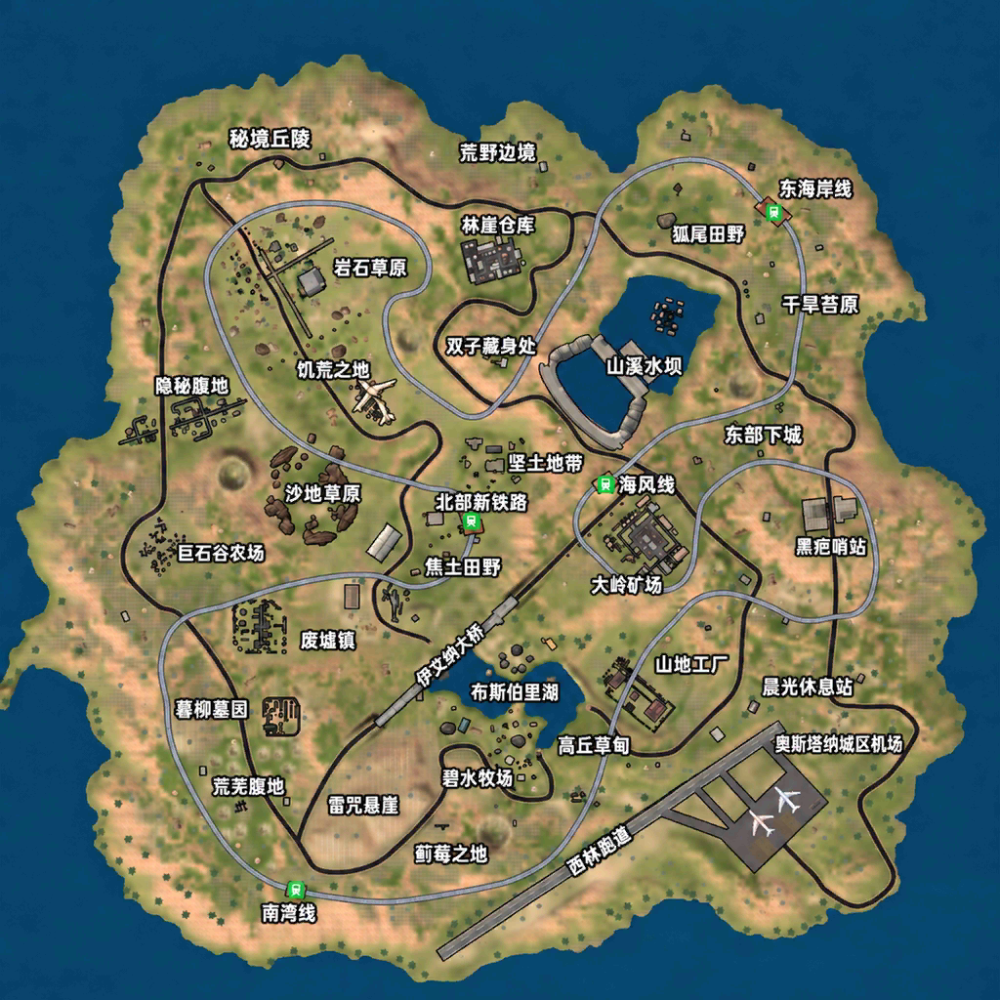

# 当前正式版：0.14.90

[下载正式版](https://github.com/zqzhuhai-commits/Swag-Shooter-Switch/releases/tag/v0.14.90) · [本次发布说明](RELEASE-0.14.90.md)

# 绝地精英 AI增强版 0.14.90 / Xiao Fan

Atmosphère 原生单文件 NSP，应用 ID：01AF534741470000。

## 本次正式发布

- 恢复游戏原始准心及颜色设置，撤回曾造成实战黑方块的四种自定义样式、材质覆盖和画布重建处理。
- 合并近期第三人称视角、步态与输入适配；支持按住 ZL 开镜时陀螺仪辅助瞄准。
- 保留中文地图、四档 AI、52人13支四人小队、缩圈和圈外伤害适配、离线奖励与存档。
- 保留第三人称曳光显示调整；不将模拟校验视作弹道对齐的全面实机验证。

## 安装与操作

下载 Swag-Shooter-0.14.90.zip，解压后安装 NSP；无需额外资源或 NRO。升级前备份 SD /switch/swag-userdata/、/switch/swag-ai.cfg，若使用体感自定义配置也备份 /switch/swag-gyro.cfg。

左摇杆移动；L3短按切换跑步、长按切换视角；右摇杆转动视角；R3短按趴下、长按交互/上车。B跳跃，A短蹲/长趴，Y短按拾取第一项/长按换弹，X切枪。ZL按住开镜，ZR开火；L医疗，R手雷；+地图，-背包。驾驶自动识别：左摇杆前后、右摇杆左右，十字键四向亦可，ZR油门、ZL倒车/刹车、A下车。

体感仅在有效步战且按住ZL开镜时辅助瞄准。线上与私人服务器保持锁定，不提供局域网联机。

## 发布与验证

2026年11月3日用户批准正式发布。使用刚才交付的同一份0.14.90 NSP，不重新编译。编译、原始准心文件逐字节一致、原自定义挂钩移除、菜单预览恢复、1876项内嵌资源哈希和独立NSP校验通过。正式发布授权不代表所有地图、设备和玩法均已穷尽实测；0.14.90恢复后的准心效果尚未收到单独实机反馈。

NSP SHA-256：de6c528b580559349aacdd57ba0e71e054769e7a508256dc345331537b26ed1a

---

以下保留操作与历史适配说明；历史测试版标记不代表当前下载版本。

# 绝地精英 AI增强版 — Switch移植

作者：**Xiao Fan**。当前源码／测试版：**0.14.72**；公开正式版：**0.14.58**。适用于Nintendo Switch Atmosphère，采用包含游戏资源的单文件NSP。

[中文首页与按键表](README.md) · [完整游戏说明](GAME_GUIDE.zh-CN.md) · [0.14.72测试说明](RELEASE-0.14.72.md) · [正式版下载](https://github.com/zqzhuhai-commits/Swag-Shooter-Switch/releases/latest)

## 当前测试版

- 第一／第三人称可切换：短按L3切换跑步，长按L3切换视角；按住ZL回到第一人称瞄准。
- 第三人称机位小幅右移0.18米，让人物位于准星左侧，避免头部挡住准星；上半身保留微幅摆动。
- 行走目标0.45完整步态周期/秒、跑步0.65周期/秒，同时限制原动画状态倍率；实际自然感、步频及机位仍待实机确认。
- 中文地图、中文启动与菜单图片、加载提示署名小帆。
- 血量低于50%开始柔和红边；30%～50%为1Hz，低于30%为2Hz，保留宽渐变和淡出。
- 首屏皇家骑士推广弹窗禁用；线上和私人服务器入口永久锁定，不提供局域网联机。

经典组队为52人、13支四人小队，你与3名AI队友同队。四档AI难度、圈内寻路与圈外伤害补偿、约15分钟自定义缩圈、离线商店、奖励及SD卡存档均保留。

## 操作与数据

步战：左摇杆移动，L3短按跑步／长按视角；右摇杆视角；R3短趴／长按交互上车；B跳；A短蹲／长趴；Y短按拾取第一项／长按换弹；X切枪；ZL按住开镜；ZR开火；L医疗；R手雷；＋地图；－背包。

驾驶：自动识别，左摇杆前后、右摇杆左右，十字键四向可用，ZR油门、ZL刹车倒车、A下车。

升级前备份SD `/switch/swag-userdata/` 与 `/switch/swag-ai.cfg`。日志默认关闭，需要诊断时创建 `/switch/swag-debug.flag` 后重启；步频诊断包含 `GAIT_CONTROL`。

## 构建与验证

[资源准备与构建步骤](docs/BUILD-0.14.72.zh-CN.md)。原游戏资源、字体替换资源和本地打包密钥需自行准备；源码仓库不包含这些大体积输入、原始设备日志或NSP安装包。

0.14.72已完成完整编译、ARM64规则与步态策略回归、1875个内置文件哈希及独立NSP校验。第三人称最终步频、遮挡、动画自然感等仍待实机确认，不将主机校验等同于硬件验证。
